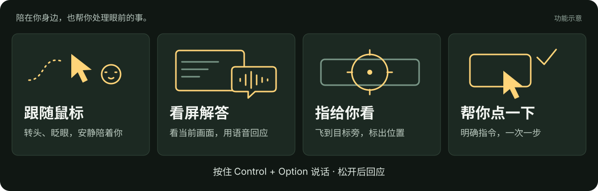
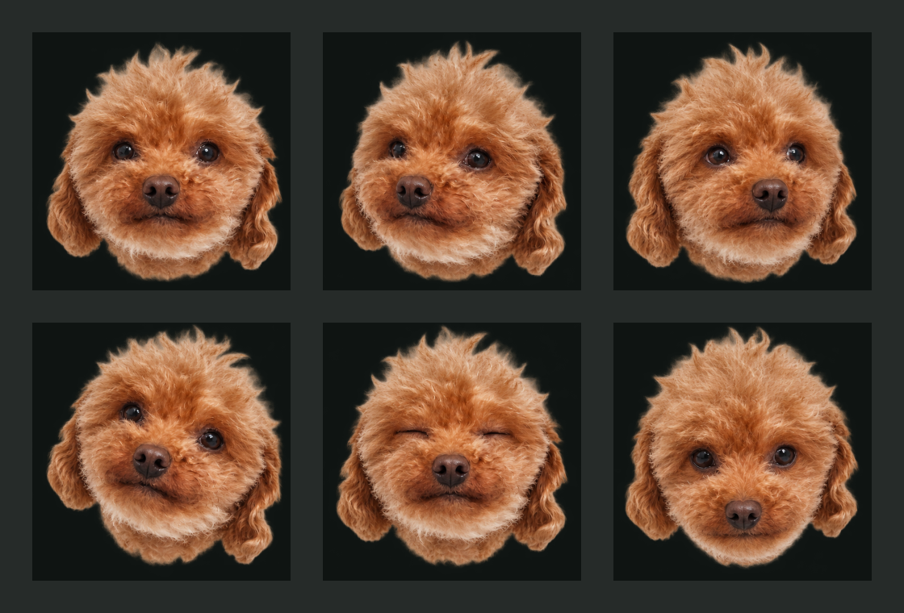
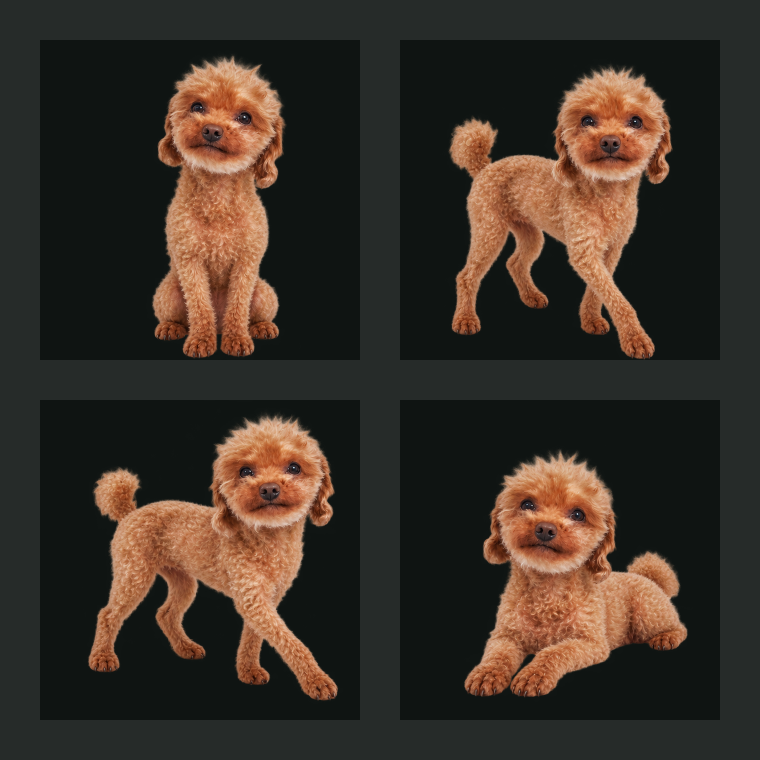

# 壮壮 · Matilda

一只陪在鼠标旁边的 Mac 语音伙伴。会听你说话、看懂当前屏幕、指给你看，也能帮你点一下。

按住 **Control + Option** 说话，松开后，她就会回应。

## 她能帮你做什么

| 你想做的事 | 壮壮会怎么回应 |
| --- | --- |
| 安静地陪着你 | 跟随鼠标，转头、眨眼；你说话时停下来听，不用时自动隐藏。 |
| “这个页面是做什么的？” | 看当前屏幕，解释页面、按钮、提示和可见内容，再用语音回答。 |
| “帮我读一下这段文字。” | 识别画面中的文字，帮你阅读、解释或整理。 |
| “保存按钮在哪？指给我。” | 飞到目标旁边，用标记圈指出具体位置。 |
| “帮我点一下它。” | 承接刚才的对话，重新确认当前位置，再执行点击。 |
| “打开微信”“往下翻一点”“关闭当前窗口” | 打开已安装应用、滚动页面，或关闭当前窗口。 |
| 接着问“那这个呢？” | 保留最近十轮文字对话，支持围绕当前话题连续交流。 |

## 指得更准，也能动手

新版加入了**文字核对与控件中心校准**，改善小按钮偏移、相邻按钮选错的问题。指向和视觉点击共用这套定位能力：不是只告诉你“在左边”，而是落到具体控件上。

在 **Screen Control** 中打开“允许壮壮操作屏幕”，就可以使用：

- **单击、双击、右键**：“点击 Export CSV，不是 Export PDF”“双击打开报告.pdf”。
- **滚动**：“向下滚动一点”“往上翻一页”。
- **打开与关闭**：“打开 Chrome”“关闭当前窗口”。

“指一下”只指不点；明确说“点击”才操作。目标不清楚时她会问你，执行中再次按住 **Control + Option** 即可打断。开关默认关闭，关掉后仍可聊天和指路。

目前每次执行一步，不会自动完成一串任务，也不支持输入文字、拖拽或画图。精确校准适用于本地 macOS 代理，仍可能遇到无法识别的界面。

## 现在的壮壮

形象参考壮壮本来的照片：小巧、偏瘦的玩具泰迪。默认是轻巧的小头像，也可以切换成有坐姿、迈步和趴姿的小身体。

<table>
  <tr>
    <th width="60%">小头像 · 六种姿态</th>
    <th width="40%">小身体 · 坐下、迈步、趴着</th>
  </tr>
  <tr>
    <td></td>
    <td></td>
  </tr>
</table>

以上为当前应用素材的实际渲染。头像上排是正面、左看、右看，下排是聆听、眨眼、点头；外观设置里可以逐个预览。

## 按你的习惯来

- **外观**：选择头像或小身体，调整大小、跟随距离、速度、光晕和自动隐藏。指向后的气泡可以是“汪，汪汪”、目标名称、自定义文字，也可以不显示。
- **声音与回答**：搜索、试听音色，调整音量、语速、音调和回答长短；菜单面板可回看、复制最近对话。
- **菜单栏小助手**：在头像旁查看 Codex 剩余周额度，自选是否显示及刷新频率，不打扰主要的陪伴功能。

## 开始使用

需要 macOS 14.2+、Xcode、Node.js 22+，以及 MiniMax 和腾讯云 ASR 的 API 凭据。

1. 按 [安装与配置](docs/DEVELOPMENT.md#安装与启动) 启动本地代理，并用 Xcode 运行 App。
2. 为壮壮开启麦克风、辅助功能和屏幕录制权限。
3. 按住 **Control + Option** 说话，松开后等待回应。
4. 想让她点击时，再到 **Screen Control** 打开操作开关。

语音识别使用腾讯云 ASR，屏幕理解和语音回答使用 MiniMax。当前截图与最近文字上下文会发送给模型服务，历史截图不会重复发送；聊天只保留在本次运行的内存中。API Key 留在代理配置里，不打包进 App。

## 为什么是壮壮

壮壮是我已经去世的小狗。我希望她还能以另一种方式每天陪着我：不需要一直说话，安静地待在身边；有问题时，叫她一声。

项目基于 [farzaa/clicky](https://github.com/farzaa/clicky) 改造，重新设计了形象、语音、屏幕理解和交互。感谢原作者的开源工作，本项目继续使用 [MIT License](LICENSE)。

---

[安装、配置与开发](docs/DEVELOPMENT.md) · [更新记录](docs/MAIN_CHANGES.md) · [形象素材](docs/COMPANION_MOTION_ASSETS.md)
