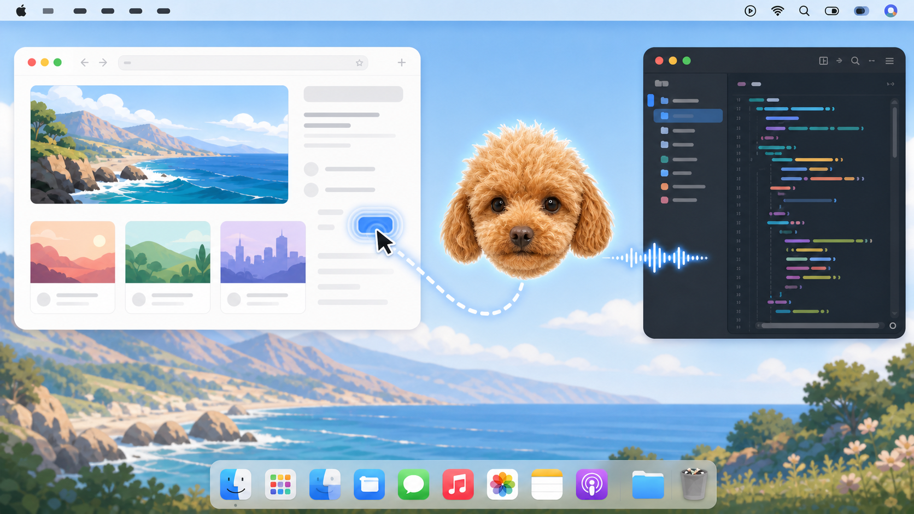

# 壮壮 · Matilda

> 一只住在 Mac 菜单栏里、每天跟着鼠标陪伴我的语音伙伴。



## 为什么是壮壮

壮壮是我已经去世的小狗。

我希望它还能以另一种方式每天陪着我：平时安静地跟在鼠标旁边；当我看不懂一个页面、找不到某个按钮，或者只是想聊聊时，我可以直接开口问它。它会结合眼前的屏幕回答，也会跑到相关位置旁边，告诉我应该看哪里。

这个项目最初基于 [farzaa/clicky](https://github.com/farzaa/clicky)，后来逐步换掉了模型、语音和服务，也重新设计了形象、动画、面板和交互。现在它是我的定制版本：英文产品名是 **Matilda**，显示在应用和菜单栏里的名字是 **壮壮**。

## 怎么和它相处

1. 启动壮壮，它会留在 Mac 顶部菜单栏，并用头像跟随鼠标；
2. 按住 `Control + Option`，直接说出你对当前页面的疑问；
3. 松开按键，壮壮会看着当前屏幕回答；
4. 如果答案涉及一个可见的按钮、图标、文件或界面区域，它会移动过去，并用脉冲圈标出位置；
5. 没听清时，打开菜单栏面板查看最近对话，也可以复制回答中的文字。

例如可以问：

- “这是什么页面？”
- “这个按钮为什么不能用？”
- “微信图标在哪里？”
- “我应该点哪个？”
- “把当前画面里的文字提取出来。”

## 现在能做到什么

- **陪伴**：以壮壮照片为参考的头像会转头关注鼠标、自然停靠、眨眼，并在你说话时停下来侧耳听；也可以在外观设置切换为纤细的“小身体”，移动时迈步，安静时坐下或趴着；
- **看懂屏幕**：结合当前截图解释页面、软件、按钮和可见内容；
- **语音交流**：按住快捷键说话，松开后获得语音回答；
- **视觉指引**：在需要寻找可见目标时移动到附近，并显示可调节的目标圈；
- **轻量屏幕操作**：开启 Screen Control 后，可以按明确指令单击、双击、右键、滚动、打开已安装应用或关闭当前窗口；实际发出操作后会有轻点头与短暂落点反馈，不额外占用模型调用；
- **回看与复制**：菜单栏面板保留最近十轮对话；
- **调整回答**：可以选择简短、默认或详细回复；
- **调整声音**：可以搜索和试听 MiniMax 音色，并设置音量、语速和音调；
- **调整外观**：可以选择头像或小身体，以及大小、跟随距离、快中慢速度、泛光、自动隐藏和指向标记；菜单栏布局保持不变；
- **查看 Codex 周额度**：可以在菜单栏头像右侧查看剩余周额度，并通过独立的 Codex 用量设置控制显示内容；
- **多显示器使用**：会识别鼠标所在屏幕，并在对应屏幕显示壮壮和目标位置。

## 目前的边界

壮壮主要负责回答问题、理解当前屏幕、提供视觉位置指引，并可选择开启轻量单步操作。

Screen Control 默认关闭；开启后，明确的单步操作指令直接执行，目标不清楚或画面变化时才澄清。它目前不会自动连续操作、输入文字、拖拽、画图或执行脚本。定位使用当前截图与本地精确校准，仍不能保证所有控件都准确；动作反馈表示输入已发出，不等于业务任务已经成功。项目没有内置互联网搜索，因此涉及刚刚发生的新闻或最新资料时，回答可能不完整。

## 从 Clicky 到 Matilda

本项目保留了 Clicky 的菜单栏助手和屏幕指引想法，但当前版本已经完成这些主要改造：

- 用 MiniMax-M3.1-Flash（默认 low 思考深度）负责屏幕理解和问答，保留 MiniMax-M3 兼容；
- 用腾讯云实时 ASR 识别语音，并保留 Apple Speech 作为本地备用；
- 用 MiniMax TTS 生成语音，支持边生成边播放、音色搜索和试听；
- 支持本地 Node 代理，不注册 Cloudflare 也可以运行；
- 加入最近对话、复制、回答长度、音色和外观设置；
- 将蓝色三角形改造成以壮壮为原型的头像、动画、菜单栏图标和应用图标；
- 将鼠标跟随和自动隐藏改成按需运行，避免壮壮空闲时持续占用资源；
- 修复长时间运行后回复状态可能卡住的问题，并在网络或语音播放异常时自动恢复；
- 加强连续提问、语音取消、目标坐标和错误回退的稳定性；
- 移除原项目的遥测、发布脚本和当前版本不再使用的服务。

本地 `main` 相对上一版 GitHub 主分支的逐项整理见 [main 分支改动说明](docs/MAIN_CHANGES.md)。

## 运行前准备

需要：

- macOS 14.2 或更高版本；
- Xcode；
- Node.js 22 或更高版本；
- MiniMax API Key；
- 腾讯云 ASR 的 `AppID`、`SecretId` 和 `SecretKey`。

### 1. 启动本地代理

API Key 不写进 App，而是放在本地代理的配置文件中：

```bash
cd worker
npm install
cp .dev.vars.example .dev.vars
```

编辑 `worker/.dev.vars`：

```text
MINIMAX_API_KEY=你的_MiniMax_Key
TENCENT_ASR_APP_ID=你的腾讯云_AppID
TENCENT_ASR_SECRET_ID=你的腾讯云_SecretId
TENCENT_ASR_SECRET_KEY=你的腾讯云_SecretKey
```

然后启动：

```bash
npm run local
```

推荐聊天配置（不要把思考深度写进 `MINIMAX_THINKING_TYPE`）：

```text
MINIMAX_CHAT_MODEL=MiniMax-M3.1-Flash
MINIMAX_THINKING_TYPE=adaptive
MINIMAX_REASONING_EFFORT=low
MINIMAX_MAX_TOKENS=8192
```

M3.1 Flash 始终思考，不能设为 `disabled`。思考深度支持 `low`、`medium`、`high`、`xhigh`、`max`，代理用 Anthropic 的 `output_config.effort` 发送，默认选 `low` 以控制语音延迟。思考与答案共用输出预算，代理为 M3.1 保留至少 8192 tokens；更高深度可相应调高 `MINIMAX_MAX_TOKENS`。旧配置 `MINIMAX_THINKING_TYPE=low` 仍可迁移识别；显式 effort 优先。MiniMax-M3 继续支持 `disabled/adaptive/omit`。

本地服务在启动时读取配置，保存文件后需重启。若使用本机的 `com.clicky.local-proxy` 登录服务：

```bash
launchctl kickstart -k gui/$(id -u)/com.clicky.local-proxy
```

屏幕指向通过 MiniMax 自定义函数 `point_to_screen` 返回目标边框和截图编号。代理检查边界并计算中心，再转换成现有 App 的 `POINT_V2` 指示标签；文本中的旧坐标不能绕过工具校验。此工具只定位和指示，不执行鼠标点击、拖动、绘画或键盘输入。无目标、非法输入和多次互相冲突的调用均不放置指示圈。它不是 Claude 专用 `computer_*` 工具的原样移植。

参数契约来自 [MiniMax Anthropic API](https://platform.minimax.io/docs/api-reference/text-anthropic-api)，工具协议参见 [MiniMax Tool Use](https://platform.minimax.io/docs/guides/text-m3-function-call)。

浏览器直接访问 `http://localhost:8787/` 显示 `Method not allowed` 是正常的。这个服务只接收 App 发出的指定请求。

### 2. 用 Xcode 启动壮壮

```bash
open leanring-buddy.xcodeproj
```

在 Xcode 中：

1. 选择 `leanring-buddy` scheme 和 `My Mac`；
2. 在 Signing & Capabilities 中选择自己的 Team；
3. 按 `Cmd + R` 构建并运行。

壮壮只出现在顶部菜单栏，不显示在 Dock。首次运行需要授权：

- 麦克风：听到你的问题；
- 辅助功能：识别全局 `Control + Option` 快捷键；
- 屏幕与系统录音：截取当前屏幕；
- 屏幕内容：通过系统 Screen Content picker 允许读取可分享的屏幕内容。

开发时尽量保持同一个签名和安装位置。不要在终端使用 `xcodebuild`，否则 macOS 可能把构建结果识别成另一个 App，并要求重新授权。

## 声音与外观

点击菜单栏中的壮壮头像，可以：

- 查看最近对话并复制回答；
- 调整回答长度；
- 打开语音设置，搜索和试听 MiniMax 音色；
- 设置语音音量、语速和音调；
- 打开外观设置，在“形象与动作”直接查看正面、左看、右看、聆听、眨眼和点头，或选择小身体；“跟随与显示”调整距离、速度与自动隐藏；
- “指向提示”可以选择“汪，汪汪”、实际目标名称、自定义文字或不显示，气泡不会额外发声；壮壮激活时也可从 Matilda 菜单的 Appearance 打开设置；
- 调整头像大小、鼠标距离、跟随速度、泛光、自动隐藏时间和目标圈样式；
- 打开 Codex 用量设置，查看剩余周额度并选择是否显示在菜单栏。

## 可选：部署 Cloudflare Worker

本地 Node 代理已经可以完整运行。只有希望开机后不再手动启动本地服务时，才需要部署 Cloudflare Worker：

```bash
cd worker
npm install
npx wrangler secret put MINIMAX_API_KEY
npx wrangler secret put TENCENT_ASR_APP_ID
npx wrangler secret put TENCENT_ASR_SECRET_ID
npx wrangler secret put TENCENT_ASR_SECRET_KEY
npx wrangler deploy
```

部署后，把 `leanring-buddy/Info.plist` 中的 `WorkerBaseURL` 改成自己的 Worker 地址。

## 数据与隐私

- API Key 只保存在本地 `worker/.dev.vars` 或 Cloudflare secrets，不写入 App 包；
- 语音会发送给腾讯云 ASR；
- 问题、最近对话上下文和当前屏幕截图会经代理发送给 MiniMax；
- 项目不包含原作者的 PostHog 遥测；
- Release 版本不会把转写、模型回答或屏幕文字写入本地明文日志；
- `.gitignore` 已排除本地凭据、Node 依赖、构建产物、日志和生成音频。

## 给开发者

一次交流大致经过：

```text
按住 Control + Option
  → 腾讯云 ASR 将语音转成文字
  → ScreenCaptureKit 获取当前屏幕
  → 本地 Node 或 Cloudflare 代理转发给 MiniMax
  → MiniMax 回答按句进入流式 TTS
  → 需要指引时，壮壮移动到模型给出的屏幕位置
```

代理提供 `/chat`、`/tts`、`/tts-stream`、`/voices` 和 `/transcribe-url`。详细工程结构、测试约定和文件职责见 [AGENTS.md](AGENTS.md)。

Worker 检查：

```bash
cd worker
npm test
npm run typecheck
node --check local-server.mjs
```

需要真实 MiniMax API 的定位 smoke test 使用合成界面图，不读取桌面，且不纳入 `npm test`。从 `worker/` 执行：

```bash
swift -module-cache-path /private/tmp/matilda-swift-module-cache test/fixtures/make-grounding-fixture.swift /private/tmp/matilda-grounding-fixture.png
node test/check-live-grounding.mjs /private/tmp/matilda-grounding-fixture.png
```


### 公开 Computer Use 协议试用（API，无需 MiniMax Code）

`worker/.dev.vars` 中设置 `MINIMAX_POINTING_MODE=computer`，再重启本地代理，就能按原来的 Control + Option 方式让壮壮指位置。设回 `custom` 则恢复原有 `point_to_screen`；普通聊天、TTS 和 Mac App 不需要重建。模板与远端 Worker 仍默认 `custom`，没有自动部署。本机在 2026-10-20 为用户试用启用了 `computer`。

参考来源是 [OSWorld 的公开 M3 Agent](https://github.com/xlang-ai/OSWorld/tree/c0f31bbeec1252599f46b2932fdb1fab7292c23e/mm_agents/m3)，固定版本 `c0f31bbeec1252599f46b2932fdb1fab7292c23e`。保留其 system prompt、`<tool_call>{"name":"computer",...}</tool_call>` 动作协议、0–1000 坐标与 macOS 键位后缀；环境描述改为真实 macOS，并补充只读单步限制。原文及 Apache-2.0 许可证随代码保存在 `worker/third-party/`。这不是 MiniMax Code 客户端，也不是完整 OSWorld 环境或 M3.1 官方评测的等价复现。

M3.1 Flash 可以使用：官方明确列出其 Computer Use 能力及 API 可用性，参考代码名中的 M3 不代表 API 仅限 M3。本机继续使用 `MiniMax-M3.1-Flash`、`adaptive`、`low`。computer 定位只取当前指定屏幕的一张截图（默认主焦点截图；明确“第二个屏幕”时选第 2 张），不携带旧截图或旧坐标。独立命名的目标直接定位；“你指给我／再指一次”等承接式追问先用最近最多十轮文字对话解析目标，再将完整目标交给当前截图定位和本地校准。此时多一次文字模型请求，普通聊天和独立定位不增加该请求。未建立或有歧义的目标会询问“哪个”，不说成目标突然消失。模型返回的 `mouse_move` 或 `left_click` **都只转换为指示圈，不真正移动系统鼠标或点击**。其他动作、多个调用、格式错误、越界坐标、`[INFEASIBLE]` 均不画圈，不自动回退到自定义工具。原始动作文本不进入朗读。

自然的“指给我／指一指／再指一次”均可触发指示，不再要求特定长句；“不要指、口头解释就好”和纯朗读词语不触发。明确换目标时以当前目标为准。会话只保留在本次进程内存中，最近十轮不等于永久记忆，重启后不会保留旧聊天。生产日志不记录聊天原文。

菜单下拉面板的 Response 区只保留 Length 和 Voice；原来单一的“MiniMax M3”选项不代表代理实际模型，已随轻量点击首版移除。实际模型仍由代理的 `MINIMAX_CHAT_MODEL` 设置，本机当前为 M3.1 Flash。最近十轮保留文字、不重发旧截图；用户明确选择维持此机制，不新增长度预算或摘要压缩。

### 轻量屏幕操作（实验版，默认关闭）

在菜单面板的 **Screen Control** 打开独立设置，开启“允许壮壮操作屏幕”。壮壮的设置窗口获得焦点时，也可按 Command+, 打开。关闭后不执行点击或打开应用，收到操作指令会语音提醒；聊天和指示照常。开关关闭、重新按住 Control+Option 说话，或点“停止当前操作”，会取消尚未发出的动作。

- “指一下 Export CSV 按钮”：只指，不点。
- “点击 Export CSV 按钮” / “点它”：一次单击；后者承接最近文字上下文，但重新定位。
- “双击打开报告.pdf” / “右键报告.pdf”：明确双击或右键。普通“点开链接”只单击。
- “向下滚动一点” / “往上翻一页”：一次有界滚动，优先当前鼠标区域，否则当前前台窗口中心；不调用视觉模型。
- “打开 Chrome / 微信 / Codex 等”：按本机已安装应用的名称查找并打开，不限原来的五个应用；无法按名称找到时再定位屏幕上的目标。
- “关闭当前窗口” / “帮我把这个窗口关掉”：直接调用当前窗口的系统关闭按钮，不调用视觉模型，也不等待头像飞行。
- “关闭这个弹窗”：定位并单击关闭控件；遇到另一个确认框，不自动继续。

开关开启后，你明确要求的一步操作就是授权，正常指令直接执行，不再重复询问。“能不能帮我点一下确定按钮”也按操作请求处理。已移除应用黑名单、风险关键词/确认按钮拦截、AX 名称/角色/归属硬匹配、当前窗口范围限制和鼠标移动 60 点限制；Codex、桌面、Dock、菜单栏和可见自绘按钮不会仅因所属类别被拒绝。头像飞行不再阻塞点击。

只有目标确实不清楚或截图后画面变化时才追问目标；对这种追问回答“是的”，会按当前画面重新定位，不复用旧坐标。新截图只在本地比较，不额外送给模型。仍为每次一步，不自动处理下一层保存提示或替你输入密码/指纹，不支持输入、拖绘或长任务。总开关、快捷键中断与屏幕坐标校验保留。

动作发出后检查控件值、焦点和窗口等本地状态。发现变化不等于业务任务完成；无法确认变化时会明确说明，不声称已导出文件或已完成表单。这个开关是实验能力选择，不是对任意桌面百分百正确或绝对安全的承诺。

Screen Control 设置只保留操作开关、状态和停止按钮。旧定位实验台网页及应用内练习板、自测入口已移除；开发回归测试仍保留在测试目录，不占用产品界面。

首版历史验收：四轮系统鼠标测试均为 4/4（共 16/16），并通过即时取消、重新开启不恢复旧任务的验证。那是隔离练习窗口的成绩，不是任意应用、真实语音或多屏的普遍准确率。首版较严的限制已按用户要求取消；当前“明确指令直接执行”与实验台清理状态见 `docs/MAIN_CHANGES.md` 第 16、17 节，不把旧成绩冒充新版验收。

从 `worker/` 使用同一合成图分别测试，结果可直接对比；调用会消耗少量 API 用量：

```bash
MATILDA_TEST_POINTING_MODE=computer node test/check-live-grounding.mjs /private/tmp/matilda-grounding-fixture.png
MATILDA_TEST_POINTING_MODE=custom node test/check-live-grounding.mjs /private/tmp/matilda-grounding-fixture.png
```

最初的 1440×900 合成样本曾 7/7 通过，但后续用户实测出现小关闭按钮下偏，说明该结果不能代表实际界面。使用 App 同等 3072px、质量 80 的 JPEG 重放后，原通道只通过 12/15。网页 `.light` 样式冲突已修正；文件网页不再用作自动验收入口，改用独立、无副作用的原生事件测试宿主。

### 本机精确校准与自动验收

当前本机配置为：

```dotenv
MINIMAX_POINTING_MODE=computer
MINIMAX_POINTING_PRECISION=verified
```

`verified` 保留公开 computer 协议，并补充本地校准，不再称为“未经修改的官方方案”：App 的 `temperature=0.1` 不被覆盖；明确指定的英文按钮文字先经 Vision OCR 核对，排除“不是 PDF”等否定对象，再从截图像素中找到附近紧凑控件的中心。窗口名称不会误当成按钮标签，`Save` 不会匹配成 `Saved`；目标名中的空格、大小写差异可识别。没有目标锚点或校验不可用时不回退到模型粗坐标。生产代码不包含测试按钮的位置表。

该校准目前仅支持本机 macOS Node 代理：需要已声明的 `sharp` 运行依赖及本地 Swift/macOS SDK。Vision helper 首次在私有临时缓存编译，图片仅通过 stdin 传入，不写入磁盘或日志。首次系统 Vision 初始化曾约 53 秒，后续样本大多约 2–10 秒，个别约 19 秒，不能宣称固定低延迟。Worker 仍默认 custom/raw，未部署本地校准。设 `MINIMAX_POINTING_PRECISION=raw` 并重启代理可比较原始基线，设 `MINIMAX_POINTING_MODE=custom` 可切回原自定义工具。

2026-10-20 的限定场景验收：原三题 15/15、互换/位移/缩小/不存在目标 27/27，合计 42/42；另有原生宿主内 27 次鼠标事件均命中，最大中心误差 1.46 个重放图像素，3 次不存在目标未产生事件。合成语音的 TTS → Tencent ASR 三题均保留正确目标词，但不是用户实际麦克风录音的还原。详细记录与边界见 [维护记录](docs/MAIN_CHANGES.md)。这些是给定样本的结果，不是任意桌面准确率 100% 的承诺。

上述为精确定位阶段的历史结果：`worker/test/fixtures/PointingReplayHost.swift` 只在自身测试窗口内接收 `NSEvent`，不发 CGEvent，不点击浏览器或业务应用。当时 CUA 的系统坐标点击接口返回无窗口错误，未完成系统级点击验收；不能把 27 次宿主内事件说成全局鼠标点击已验证。新的默认关闭单步控制器见上方“轻量屏幕操作”，其结果单独记录，不回填到这项旧测试。

明确选择要发送给当前 MiniMax API 的测试图文件夹后，可从 `worker/` 运行：

```bash
MATILDA_TEST_PRECISION=verified MATILDA_TEST_JPEG=1 node test/check-live-user-grounding.mjs /path/to/replay-images 5
node test/check-pointing-variants.mjs /path/to/replay-images
node test/check-live-voice-pointing.mjs
node test/check-live-pointing-followups.mjs /path/to/approved-1920x1295-csv.png 2
```

用户截图、临时测试 App 和点击数据不提交仓库；测试脚本和验收口径保留，便于以后复测。

Swift App 请通过 Xcode 界面构建和测试。当前单元测试覆盖坐标映射、指向策略、权限流程、流式分句、低资源动画和 TTS 取消。

## 上游与许可证

原始项目：[farzaa/clicky](https://github.com/farzaa/clicky)。感谢原作者公开 Clicky，并以 MIT License 允许继续学习和改造。

本仓库保留原项目版权声明并继续使用 [MIT License](LICENSE)。Matilda / 壮壮是基于个人记忆和使用需求形成的定制版本，不是 Anthropic、MiniMax 或腾讯云的官方项目。
